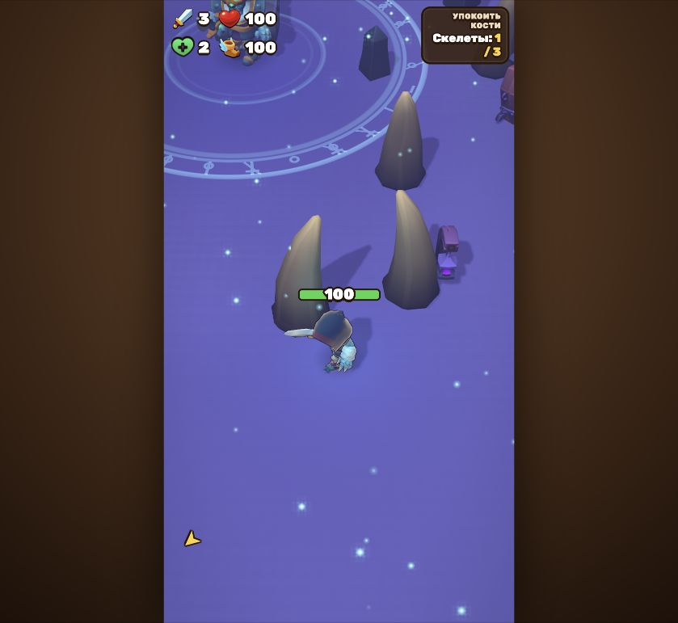

# Проверка импорта WarCry — 16 октября 2026

Проверялась локальная копия из `games/warcry` на http://127.0.0.1:5173/ во встроенном браузере Codex.

## Результаты

- `pnpm build`: успешно — проверка TypeScript и сборка пяти HTML-страниц Vite.
- `pnpm sim --runs 3 --until 5`: успешно — три моделирования по пять игровых минут. Это проверка запуска симулятора, а не подтверждение баланса.
- Загрузка 3D-сцены и вступительного диалога: успешно.
- Кнопка «Пропустить»: успешно, появляется задание «Упокоить кости».
- Движение перетаскиванием мыши (виртуальный стик): успешно.
- Автоматический бой: герой убил скелета, счётчик задания изменился с `0/3` на `1/3`, сила с `0` на `3`.
- В журнале браузера не зафиксировано ошибок уровня error. Есть предупреждения FBXLoader о недоступном TGA loader и создании placeholder texture; требуется отдельный аудит материалов.

Не проверялись: полное прохождение вступления, основной инвентарь, сохранение/загрузка прогресса, все виды оружия, боссы, сенсорное управление и производительность на реальном телефоне.

